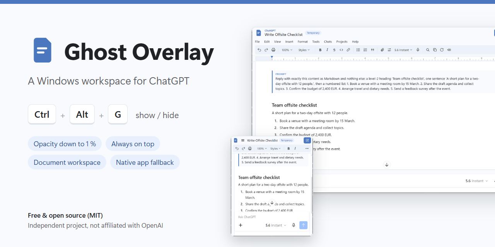
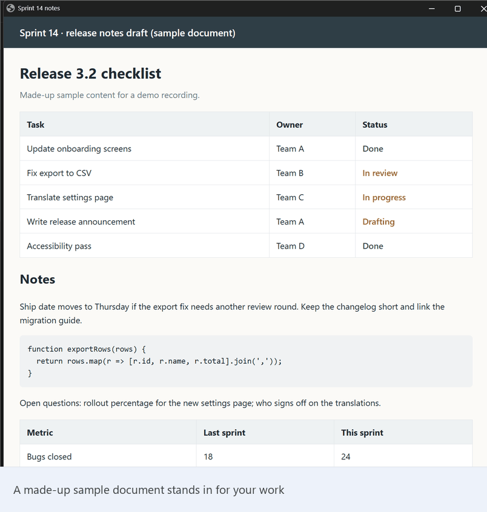
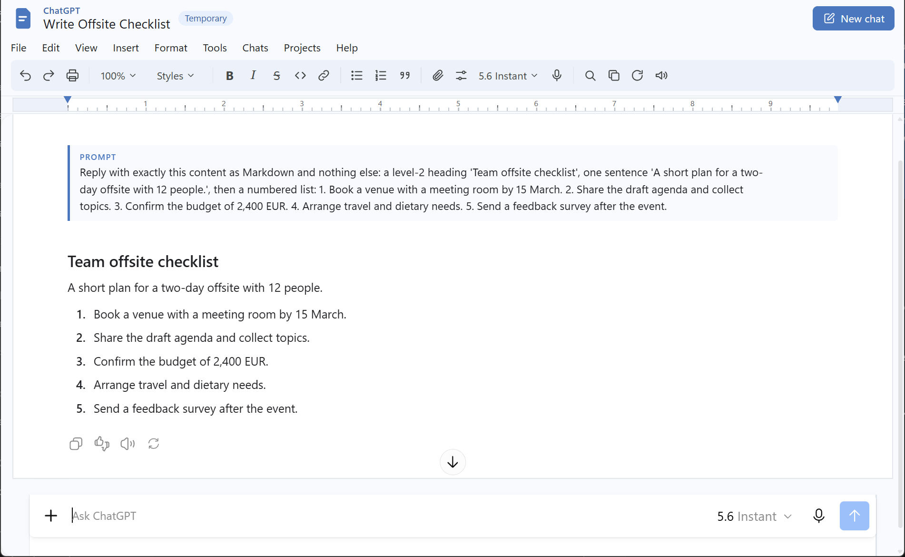
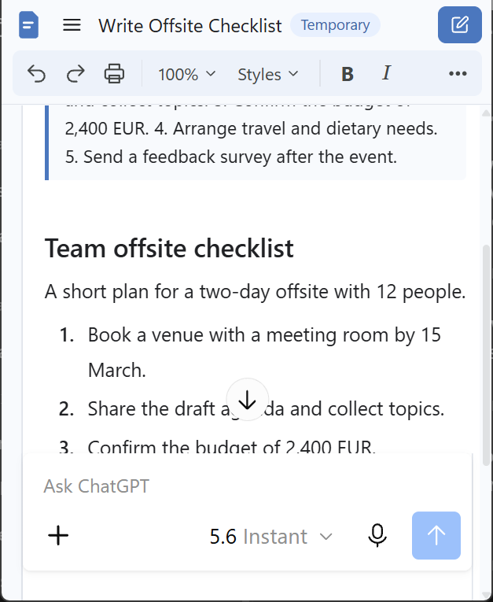
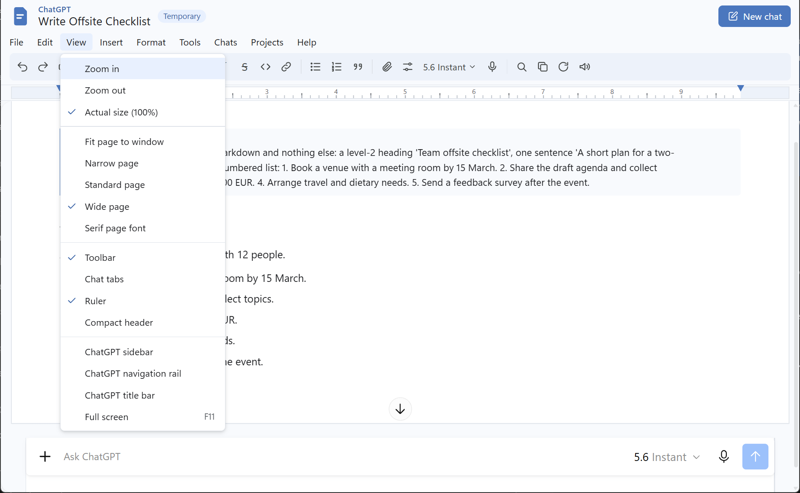

# Ghost Overlay — a Windows workspace for ChatGPT

Summon ChatGPT as a small, semi-transparent, always-on-top overlay with one hotkey, and work in it
like a document. Dismiss it with the same hotkey and focus goes straight back to what you were doing.

[](https://github.com/dreisera007/ghost-overlay-windows/releases/latest)
[](LICENSE)


<p align="center">
  <a href="https://github.com/dreisera007/ghost-overlay-windows/releases/latest"></a>
</p>

> **Independent project.** Ghost Overlay is not affiliated with, endorsed by, or sponsored by
> OpenAI, Google or Anthropic. ChatGPT is a trademark of OpenAI. Chrome is a trademark of Google LLC.
> Ghost Overlay does not modify ChatGPT or Chrome: it arranges their windows and styles your own
> chatgpt.com page locally.



> **Before you install:** the installer is an **unsigned script** (check its SHA256), the Chrome
> extension must be **loaded once by hand** ("Load unpacked"), and starting at Windows sign-in is
> **optional** (the installer asks). Details below.

## Demo



A 30-second recording of the real application. The conversation and the document behind the overlay
are made-up sample content. In this recording the workspace uses its compact layout.

<p align="center">
  
</p>
<p align="center">
  
  
</p>

## Download

**[Download the latest installer](https://github.com/dreisera007/ghost-overlay-windows/releases/latest)**
(`Install-ChatGPTGhostOverlay.cmd`, one file). Check its SHA256 against the value in the release notes.

> **The installer is not digitally signed.** It's a plain-text batch + PowerShell script, so you can
> open it in a text editor and read it before running it. Because it's an unsigned script downloaded
> from the internet, your browser may warn about the file type, and Windows SmartScreen may show an
> "unknown publisher" warning. Verify the SHA256 first. If you'd rather not run the installer, you
> can use the files from this repository directly (see [CONTRIBUTING.md](CONTRIBUTING.md)).

## Features

- **One hotkey.** `Ctrl+Alt+G` shows the overlay and focuses it; pressing it again hides it and gives
  focus back to the window you were using. Fast double-taps are queued, not dropped.
- **Adjustable transparency.** 5 % steps down to a 1 % floor, so it never goes fully invisible.
  Your setting is saved.
- **Always on top**, toggled with `Ctrl+Alt+T`. Position, size and opacity are remembered.
- **Emergency reset** (`Ctrl+Alt+Shift+R`): brings the window back fully opaque, on screen and focused,
  **without** overwriting your saved opacity.
- **Two windows, same hotkeys:**
  - **Document Workspace (default):** chatgpt.com in a dedicated Chrome app window, laid out as an
    original document editor. It has a header, menus (File, Edit, View, Insert, Format, Tools,
    Chats, Projects, Help), a toolbar, chat tabs, a ruler and a white page. Every menu item drives
    ChatGPT's own controls. Items whose control isn't available on the current page are greyed out.
  - **Native app (fallback):** the official ChatGPT Windows app, switched with one command.
- **Click-to-rename.** Click the chat title in the workspace header to rename the conversation in
  place: Enter saves, Escape cancels, clicking elsewhere saves a changed title. The real ChatGPT
  conversation is renamed (through ChatGPT's own Rename dialog), so the new title shows everywhere,
  also on your other devices. Works in ordinary and Project chats; temporary and not-yet-saved chats
  can't be renamed.
- **Responsive page.** "Fit page to window", Narrow, Standard and Wide page widths. Small overlays
  (for example 430 × 550) fold the menus into one button. Works in ordinary and Project chats.
- **Optional start at sign-in.** The installer asks; if you say yes, it adds a per-user Startup
  shortcut that prepares the window hidden, so the first `Ctrl+Alt+G` is instant.
- **No API key, no separate AI backend.** It works with your existing ChatGPT account and session in
  Chrome. The controller uses only standard Windows window calls (move, resize, opacity, topmost,
  show/hide) on one window. No admin rights and no telemetry. See
  [Privacy and security](#privacy-and-security) for exactly what the extension reads.

## Requirements

| | Tested with | Notes |
|---|---|---|
| Windows | Windows 11 (build 26200) | Windows 10 is untested |
| AutoHotkey | v2.0.23 | v2 required; the installer offers a free per-user install via `winget` |
| Google Chrome | 155 | For the Document Workspace. Other Chromium browsers are not supported |
| ChatGPT app | Microsoft Store app `OpenAI.Codex` 26.1021 | Only needed for the native fallback |
| PowerShell | 5.1 (built into Windows) | Used by the installer |

You need your own ChatGPT account (free or paid) and must be signed in to chatgpt.com in Chrome.
Ghost Overlay never asks for, reads or stores credentials.

## Install

1. Download `Install-ChatGPTGhostOverlay.cmd` from the
   [latest release](https://github.com/dreisera007/ghost-overlay-windows/releases/latest) and
   double-click it. The installer:
   - checks for the ChatGPT app, and offers the free Microsoft Store install only if you say yes
     (you can skip it if you only use the Document Workspace);
   - checks for AutoHotkey v2, and offers a free per-user install only if you say yes;
   - writes the files to `%LOCALAPPDATA%\ChatGPTGhostOverlay` (an existing configuration is kept);
   - picks the Document Workspace when Chrome is installed, otherwise the native app;
   - asks whether to start Ghost Overlay at Windows sign-in, then starts it.
2. **Load the extension once, by hand.** This step is required for the Document Workspace. Chrome
   doesn't let programs install extensions silently, and the extension isn't in the Chrome Web Store:
   1. Open `chrome://extensions` and turn on **Developer mode**.
   2. Click **Load unpacked** and choose `%LOCALAPPDATA%\ChatGPTGhostOverlay\DocumentMode\extension`.
   3. If you use several Chrome profiles, load it in the profile you use for ChatGPT, and put that
      profile's folder name in `GhostOverlay.ini` (for example `DocProfile=Profile 1`).
3. Press `Ctrl+Alt+G`.

The extension declares **no Chrome API permissions** (no `permissions` entry, no background worker).
Its content script and stylesheet are matched to `https://chatgpt.com/*`, so they load on chatgpt.com
pages in that Chrome profile. The Document Workspace switches on only when the page runs as a
standalone app window (`display-mode: standalone`); in ordinary tabs it does nothing. What it reads
and stores is described under [Privacy and security](#privacy-and-security).

Installer options (from a terminal):

```
Install-ChatGPTGhostOverlay.cmd -Startup Yes|No|Ask       (default Ask)
Install-ChatGPTGhostOverlay.cmd -Mode Document|ChatGPT     (default: keep; new installs pick Document if Chrome exists)
Install-ChatGPTGhostOverlay.cmd -InstallDir C:\Tools\GhostOverlay
Install-ChatGPTGhostOverlay.cmd -Uninstall [-InstallDir ...]
```

Use an install folder without spaces. You can also run from a clone of this repository: see
[CONTRIBUTING.md](CONTRIBUTING.md).

## Uninstall

```
Install-ChatGPTGhostOverlay.cmd -Uninstall
```

This stops the controller, hands the window back as a normal window, removes this copy's Startup
shortcut and deletes the installed files. Then remove **Ghost Overlay Document Mode** in
`chrome://extensions`. ChatGPT, Chrome and AutoHotkey stay installed.

## Keyboard shortcuts

| Keys | Action |
|---|---|
| `Ctrl+Alt+G` | Show / hide the overlay. Opens the window if it isn't open yet (Document: about 2 s) |
| `Ctrl+Alt+Up` | More opaque (+5 %) |
| `Ctrl+Alt+Down` | More transparent (−5 %, down to 1 %; never fully invisible) |
| `Ctrl+Alt+T` | Toggle always-on-top |
| `Ctrl+Alt+Shift+R` | Emergency reset: temporarily 100 %, default size, bottom-right of the primary screen, focused. Saved opacity is kept |

Inside the Document Workspace, `Alt+Shift+M` opens the menus.

The tray icon (green **H**) offers Show/Hide, Reset, Mode, Open config, Reload and Exit.

## Switching windows

```
Switch-Mode.cmd ChatGPT     # native ChatGPT app overlay
Switch-Mode.cmd Document    # Document Workspace (default)
```

…or use tray → Mode. The setting is saved, and the previous window is handed back as a normal window.

## Configuration

`GhostOverlay.ini` sits next to `GhostOverlay.ahk` and is created on first run. See
[`GhostOverlay.example.ini`](GhostOverlay.example.ini) for every key. After editing, use tray →
**Reload config**.

| Key | Default | Meaning |
|---|---|---|
| `Target` | `ChatGPT`; the installer sets `Document` when Chrome is installed | `Document`, `ChatGPT` (Store app) or `Classic` (ChatGPT Classic) |
| `Width` / `Height` | `430` / `550` | Overlay size in DPI-independent pixels |
| `Opacity` | `30` | Percent; saved by the opacity hotkeys |
| `OpacityStep` / `MinOpacity` | `5` / `1` | Step per keypress and the floor |
| `AlwaysOnTop` | `1` | Saved by `Ctrl+Alt+T` |
| `DocProfile` | blank | Chrome profile folder; blank = Chrome's last-used profile |
| `DocBrowser` / `DocUrl` | blank / `https://chatgpt.com/` | Path to `chrome.exe` (blank = found automatically) and the start page |

## Privacy and security

**Your account and session.** Ghost Overlay needs no OpenAI API key and runs no AI backend of its own.
The Document Workspace is chatgpt.com in a Chrome app window, signed in with your existing ChatGPT
session in your Chrome profile. Ghost Overlay never asks for, reads or stores passwords, cookies or
tokens.

**What the extension reads, locally in the page.** To build the workspace, the content script reads
ChatGPT's own page in your browser:

- ChatGPT's navigation: chat titles and links, project names and the chats inside them (for the chat
  tabs and the Chats and Projects menus). To find this list it may briefly open ChatGPT's own
  navigation panel in the background.
- The current conversation title and the selected model name (for the header and toolbar).
- The displayed conversation text, only when you use **Find**, **Word count**, **Print** or
  **Download as text**.
- Your clipboard, only when you choose **Edit → Paste**.

**What it stores.** Only its view preferences (page width, zoom, toolbar, ruler and similar), in
chatgpt.com's `localStorage`. That storage belongs to the chatgpt.com origin in your Chrome profile,
so it's shared by all chatgpt.com pages there, not only the overlay window. Downloads are created
locally in your browser and saved only where you choose.

**What it sends.** The extension makes no network requests of its own and has no telemetry. ChatGPT
itself keeps communicating with OpenAI as usual: sending prompts, loading chats and uploading files
you attach. The workspace's buttons use ChatGPT's own controls, so those actions behave exactly as if
you'd clicked them in ChatGPT. The only link it opens itself is Help → ChatGPT Help Center, when you
click it.

**Renaming a chat.** When you rename a chat from the workspace title, the extension opens ChatGPT's own
"Chat actions → Rename" dialog for the conversation in the address bar, enters your new title and
presses Save; ChatGPT then saves it to your account as it would if you'd done it by hand. The dialog
is kept out of sight while this happens. The workspace reports success only once ChatGPT shows the new
title; otherwise it restores the real title or shows ChatGPT's dialog so you can finish there.

**Permissions.** No Chrome API permissions are declared. Like any content script, it can see and
change the chatgpt.com pages it's matched to; it switches the workspace on only in the standalone app
window.

**The controller** (`GhostOverlay.ahk`) only arranges one window and doesn't read page content.
`GhostOverlay.log` (next to the controller) records window handles, window sizes, modes and
saved-opacity changes. For each saved opacity change it also notes how many Ctrl+Alt+Up/Down presses
caused it, whether Ctrl and Alt were physically held, and the name of the program in front. It records
no other keys and no text.

**Transparency is not privacy.** Screen sharing, recordings and people near you can still see a
translucent window. Hide it with `Ctrl+Alt+G`.

> Installers before v2.1.0 contain an older copy of this README with less precise wording ("never
> reads … your conversations", "no permissions"). The extension's behavior was the same; this section
> is the accurate description.

Found a vulnerability? Please follow [SECURITY.md](SECURITY.md).

## Known limitations

- **Depends on ChatGPT's page structure.** The workspace hooks ChatGPT's own `data-*` attributes. A
  ChatGPT update can break some styling or menu items until Ghost Overlay is updated. Meanwhile,
  use File → Original ChatGPT layout or `Switch-Mode.cmd ChatGPT`.
- **Chrome only** for the Document Workspace (Google Chrome at its standard install path, or
  `DocBrowser=`).
- **The extension is loaded unpacked**, so Chrome shows its usual developer-mode notice.
- **Chrome's thin title bar** follows your Chrome profile theme; a page can't recolour it.
- **Native app minimum size** is about 547 × 684, so 430 × 550 is clamped in native mode.
- **Projects menu lists no projects** (since a ChatGPT navigation change, also in v2.0.4). Use
  Projects → All projects… to open ChatGPT's Projects page meanwhile. Renaming chats inside projects
  isn't affected.
- **Chat list freshness:** ChatGPT's own chat list in an open window may show a chat's older title
  until that chat is opened or the page is refreshed (for example after renaming it on another
  device). The open chat always shows its current title.
- **Untested:** Windows 10, multiple monitors, a real sign-out/sign-in (startup was tested by
  launching the real Startup shortcut), and ChatGPT Classic in this release.

## How it works

The controller (`GhostOverlay.ahk`, AutoHotkey v2) registers the five hotkeys. It applies opacity
and topmost to one window and runs a 1.5 s watchdog that re-applies them if anything resets them
(~0.01–0.05 % CPU, ~17 MB RAM). The Document Workspace is a Manifest V3 content script and
stylesheet in [`DocumentMode/extension`](DocumentMode/extension). [docs/TESTING.md](docs/TESTING.md)
lists what has been verified and how.

## Contributing

Bug reports, ideas and pull requests are welcome. Please read [CONTRIBUTING.md](CONTRIBUTING.md)
first, and never paste real conversation content into issues or screenshots.

## Acknowledgements

Ghost Overlay was developed with AI assistance (Anthropic's Claude). The maintainer directed,
reviewed and tested the work; the test results are in [docs/TESTING.md](docs/TESTING.md).

## License

[MIT](LICENSE). Copyright (c) 2026 dreisera007.
